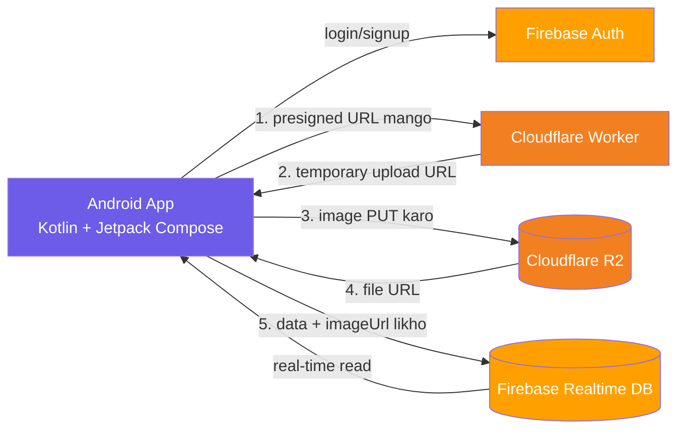
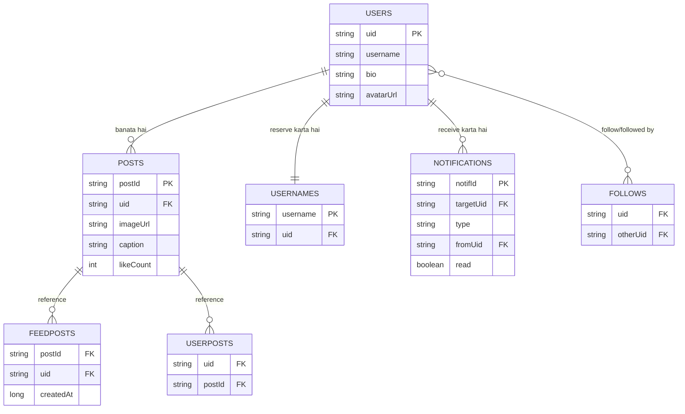
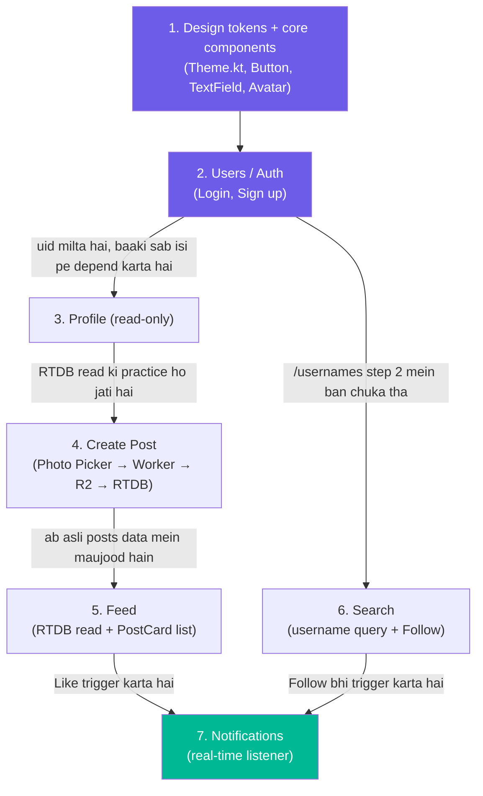

# Zubair Social — Project Plan

Ek simple Instagram-clone **native Android app**, jo learning project ke taur pe banayi ja rahi hai.
Main learning goal: **Design Systems** (reusable components, design tokens, consistent UI) — sath mein basic Firebase aur cloud storage integration.

> Status: Abhi sirf planning hai. Koi code nahi likha gaya.

---

## 1. Platform & Stack

| Layer | Choice | Kyun |
|---|---|---|
| Client | Native Android — Kotlin + Jetpack Compose | Compose mein UI reusable functions ki tarah banta hai — "design system" wali soch ke liye perfect fit |
| Auth | Firebase Authentication | Email/password + Google Sign-In, setup minimal hai |
| Data | Firebase Realtime Database (RTDB) | Sara app data yahan store hoga (users, posts, follows, notifications); simple JSON-tree structure |
| Image storage | Cloudflare R2 | Firebase Storage ki jagah yeh explicitly choose kiya gaya hai |
| Upload signing | Cloudflare Worker (chhota serverless function) | R2 mein Firebase Storage jaisa direct-safe upload nahi hota — app R2 ki secret key apne andar nahi rakh sakti. Worker ek temporary "presigned upload URL" deta hai jab bhi app request kare. |

**Flow:** App Worker se presigned URL mangti hai → app us URL se image seedha R2 pe upload karti hai → R2 final file ka URL wapas deta hai → wo URL + post ka data Firebase RTDB mein likh diya jata hai.

Yeh ek real-world pattern hai ("signed URLs") jo sahi tareeqe se seekhne layak hai, sirf shortcut nahi.



---

## 2. Data Model (Firebase Realtime Database)

RTDB ek bada JSON tree hota hai — koi "joins" nahi hote, is liye data jaan boojh kar duplicate kiya jata hai taake reading fast rahe.

```
/users/{uid}
    username, bio, avatarUrl, createdAt

/usernames/{username} : uid
    → fast username lookup + prefix search ke liye

/posts/{postId}
    uid, imageUrl, caption, createdAt, likeCount

/userPosts/{uid}/{postId} : true
    → "is user ke posts" nikalne ke liye, sab posts scan kiye baghair

/feedPosts/{postId} : { uid, createdAt }
    → MVP feed = sab logon ke posts, newest pehle (abhi "following"-based filter nahi)

/follows/{uid}/following/{otherUid} : true
/follows/{uid}/followers/{otherUid} : true

/notifications/{uid}/{notifId}
    type (like | comment | follow), fromUid, postId, read, createdAt
```

**Search** ke liye RTDB mein full-text search nahi hota — `/usernames` pe `orderByKey().startAt(q).endAt(q + "")` se prefix search karte hain. MVP ke liye yeh kaafi hai.

### Data relationships (kaun kis se judta hai)



> Note: RTDB mein asal mein "joins" nahi hote — yeh diagram sirf logical relationship dikhane ke liye hai. Implementation mein har cheez apne path pe duplicate ho kar store hoti hai (dekho upar wala JSON tree).

---

## 3. Features (MVP scope)

| Feature | Screens | Notes |
|---|---|---|
| **Users (Auth)** | Login, Sign up | Email/password + "Continue with Google". Signup pe: `/users/{uid}` banao + `/usernames/{username}` reserve karo. |
| **Profile** | Profile | Avatar, bio, stats (posts/followers/following), posts ka grid, Edit profile. |
| **Create Post** | New post → Uploading | Photo chuno (Android Photo Picker) → Worker ke zariye R2 pe upload → `/posts`, `/userPosts`, `/feedPosts` mein likho. |
| **Feed** | Home Feed | `/feedPosts` ko `createdAt` ke hisab se parho, `PostCard` se dikhao. |
| **Search** | Search | `/usernames` pe prefix search, sath mein inline Follow button. |
| **Notifications** | Notifications | `/notifications/{uid}` pe real-time listener — likes, comments, follows, "Follow back" button ke sath. **MVP ke liye sirf in-app list hai** (push/FCM nahi — yeh v2 ka upgrade hai). |

### Yeh cheezein v2 ke liye chhodi gayi hain (Stitch design mein thi, MVP se nikal di gayi)
- **Add location** (Create Post pe) — location picker + extra data field chahiye
- **Tag people** (Create Post pe) — user search/selector UI + tagging ka data model chahiye
- **Advanced settings** (comments on/off, sharing, accessibility/alt-text) — apne aap mein ek chhota settings system hai
- **Following-based feed** — MVP feed sab ke posts dikhata hai; sirf follow kiye logon ka feed baad mein
- **Push notifications (FCM)** — MVP mein sirf in-app notification list hai

---

## 4. UI Design Reference

Design **Google Stitch** mein maujood hai (MCP se connect kiya gaya), project "Zubair Social Login Screen":
Login, Sign up, Home Feed, Create Post, Create Post (Uploading), Search, Notifications, Profile — total 8 screens, upar wale data model se match kar ke review kiye gaye.

**Design ka look:** purple/indigo accent color, saaf cards, bottom mein 5 icons wali nav bar (Home, Search, Create, Activity, Profile).

### Design se nikle reusable components (→ tumhara design system)
- `BottomNavBar` — sab main screens pe same
- `PostCard` — image + username + like/comment icons + caption (Feed)
- `FollowButton` — do states: filled "Follow" / outline "Follow back"
- `Avatar` — chhota size (list rows) aur bada size (profile header)
- `ListRow` — search results aur notifications dono mein same shape
- `PrimaryButton` — Login, Sign up, Share jaisi actions
- `TextField` — Login/Signup form ke inputs

---

## 5. Design System Plan (main learning focus)

Isko alag se treat karo, afterthought nahi:

1. **Pehle tokens** — colors, spacing, typography, radius `Theme.kt` mein define karo, koi bhi screen banane se **pehle**. Stitch design ka purple/indigo accent yahan match karo.
2. **Core components ek hi baar banao** — `PrimaryButton`, `Avatar`, `FollowButton`, `PostCard` shell, `ListRow`, `BottomNavBar`.
3. **Yeh rule yaad rakho** — agar koi UI chunk dusri baar copy-paste karne lage ho, ruk jao aur usko `@Composable` component bana do.
4. **Components ka catalog banao** — har component pe Compose ka `@Preview` use karo, taake ek visual gallery ban jaye (Storybook jaisa concept).

---

## 6. Suggested Build Order

Yeh order random nahi hai — har step agle step ke liye zaroori cheez provide karta hai (dependency chain).



1. Android Studio project setup + Firebase connect (`google-services.json`)
2. `Theme.kt` + core composables: `PrimaryButton`, `Avatar`, `FollowButton`, `PostCard` shell
3. Auth screens (Login/Signup) — Firebase Auth se connect
4. Profile screen (pehle sirf read-only)
5. Create Post (Photo Picker → Worker → R2 → RTDB write) — sirf MVP version, location/tag-people/advanced-settings ke baghair
6. Feed (RTDB se read + `LazyColumn` mein `PostCard`)
7. Search (username prefix query)
8. Notifications (RTDB real-time listener)

**Kyun isi order mein:**
- **Auth sabse pehle** kyunki har feature `uid` maangta hai
- **Create Post, Feed se pehle** kyunki Feed ko dikhane ke liye posts chahiye — wo sirf Create Post se aate hain
- **Notifications sabse aakhir mein** kyunki yeh Like (Feed) aur Follow (Search) dono ke "by-product" hain — un do features ke baghair test karne ko kuch nahi hoga

---

## 7. Open Decisions (abhi tak final nahi)

- [ ] Compose use karoge ya purana XML Views style — Compose recommended hai, lekin confirm nahi hua
- [ ] Cloudflare Worker ka exact implementation (presigned URLs ke liye) — abhi design nahi hua
- [ ] Google Sign-In abhi se chahiye ya v1 mein sirf email/password

---

*Last updated: 2026-10-04 — yeh sirf planning discussion reflect karta hai, implementation shuru nahi hui.*
