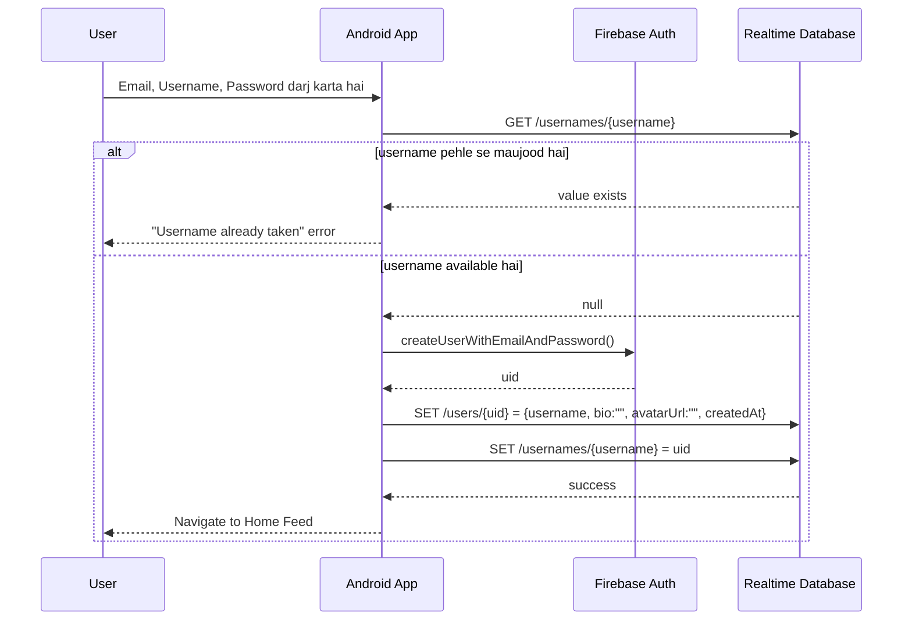
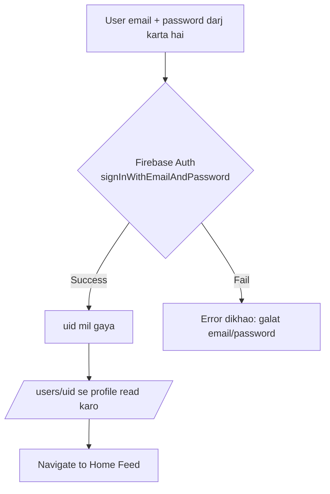

# Feature: Users (Authentication)

Login aur Sign up — app ka entry point. Har user ke paas ek unique `username` hoga jo baad mein Search aur Profile dono mein use hota hai.

## Screens
- **Login** — email + password, "Continue with Google", "Forgot password?"
- **Sign up** — email, full name, username, password, "Continue with Google"

---

## App Launch — Pehla Screen Kaun Sa Khulta Hai?

Yeh sabse pehla decision hai jo app ko lena hota hai, Login screen dikhane se bhi pehle:

1. App open hoti hai
2. App check karta hai: `FirebaseAuth.getInstance().currentUser` — kya koi session already saved hai?
   - **Haan, session maujood hai** (user pehle kabhi login kar chuka tha aur logout nahi kiya) → Login screen **bilkul skip** ho jata hai, seedha Home Feed khulta hai
   - **Nahi, session nahi hai** (pehli baar app khola, ya pehle logout kiya tha) → **Login screen** dikhta hai

> Firebase Auth SDK yeh session khud-ba-khud secure storage mein save karta hai — app ko manually token save/check karne ki zarurat nahi, bas `currentUser` null hai ya nahi, itna dekhna hota hai.

Is liye **Login screen har baar nahi dikhta** — sirf jab tak user logged in nahi hota ya jab tak wo khud logout na kare.

---

## Signup — Agar Account Nahi Hai To Register Kaise Hoga (Full Detail)

Yeh us user ke liye hai jiska **abhi tak Zubair Social pe account hi nahi hai**.

### Step by step

1. User Login screen pe "**Don't have an account? Sign up**" link tap karta hai → Sign up screen khulta hai
2. User form fill karta hai:
   - **Email** — jis se account banega
   - **Full name** — display ke liye
   - **Username** — unique handle (jaise `zubair.designs`), sirf letters/numbers/underscore
   - **Password** — kam se kam 6 characters (Firebase ka minimum)
3. Jaise hi user username type karta hai, app **debounced check** chala sakta hai (300ms ruk kar) — "yeh username available hai ya nahi" turant dikhane ke liye (optional, lekin UX ke liye acha)
4. User "**Sign up**" button dabata hai
5. App pehle **client-side validation** karta hai (network call se pehle):
   - Email ka format sahi hai? (`contains @`, etc.)
   - Username mein sirf allowed characters hain? Length theek hai (e.g. 3–20 chars)?
   - Password kam se kam 6 characters ka hai?
   - Koi field khali to nahi?
   - Agar koi check fail ho — turant inline error, network call hi nahi jata
6. Validation pass hone ke baad, app **RTDB se check karta hai**: `GET /usernames/{username}`
   - **Agar yeh username already kisi aur ke paas hai** → error: *"Username already taken"* — signup yahin ruk jata hai, user ko dusra username try karna padta hai
   - **Agar available hai** → aage badho
7. App `FirebaseAuth.createUserWithEmailAndPassword(email, password)` call karta hai
8. Firebase Auth server-side check karta hai:
   - Kya yeh **email already kisi account se registered hai**? Agar haan → fail (dekho neeche failure list)
   - Password kamzor to nahi? Email format invalid to nahi?
9. **Success** → Firebase Auth ek naya **`uid`** generate kar ke deta hai (ek unique ID, permanently is account se juda hua)
10. App ab RTDB mein **do writes** karta hai:
    - `/users/{uid}` = `{ username, fullName, bio: "", avatarUrl: "", createdAt: <now> }`
    - `/usernames/{username}` = `uid` (taake future mein koi aur yeh username na le sake, aur search/login mein username → uid lookup ho sake)
11. Dono writes complete → user ko **seedha Home Feed pe navigate** kar diya jata hai (naya account hone ki wajah se feed abhi "generic" hoga, kyunki MVP mein feed sab logon ke posts dikhata hai)

### Signup fail hone ke sab reasons

| Wajah | Kab hota hai | User ko kya dikhana hai |
|---|---|---|
| **Username already taken** | RTDB check (step 6) mein `/usernames/{username}` already exist karta hai | "Yeh username pehle se liya ja chuka hai, koi aur try karo" |
| **Email already in use** | Firebase error `ERROR_EMAIL_ALREADY_IN_USE` | "Is email se pehle se account hai — Login try karo" (+ Login link) |
| **Weak password** | Firebase error `ERROR_WEAK_PASSWORD` (6 chars se kam) | "Password kam se kam 6 characters ka hona chahiye" |
| **Invalid email format** | Client-side check ya Firebase `ERROR_INVALID_EMAIL` | "Sahi email address darj karo" |
| **Invalid username characters** | Client-side validation (step 5) | "Sirf letters, numbers, aur underscore allowed hain" |
| **No internet connection** | Network exception, Firebase call hi nahi pahuncha | "Internet connection check karo aur dobara try karo" |

> **Advanced edge case (abhi MVP ke liye sirf note):** Step 6 (username check) aur step 7 (account create) ke **beech** agar koi doosra user bhi theek usi waqt wohi username lene ki koshish kare, to dono ko "available" dikh sakta hai (race condition) — RTDB mein transaction-level safety nahi hai jaisi SQL database mein hoti hai. MVP ke liye yeh risk accept kiya ja raha hai (bohat rare scenario), lekin production app mein isay Firebase Security Rules ya Cloud Function se guard karte hain.

---

## Login — Jab Account Already Maujood Hai (Full Detail)

### Step by step

1. User Login screen pe **email** aur **password** darj karta hai
2. "**Log in**" button dabata hai
3. App pehle **client-side check** karta hai — email empty to nahi, password empty to nahi (basic sanity check, network call bachane ke liye)
4. App `FirebaseAuth.signInWithEmailAndPassword(email, password)` call karta hai
5. Firebase Auth server pe verify karta hai:
   - Kya is email se koi account exist karta hai?
   - Kya diya gaya password us account ke password se match karta hai?
6. **Success** → Firebase Auth us account ka **`uid`** return karta hai, aur session device pe automatically save ho jata hai (agli baar app khulne par Login screen skip hoga)
7. App us `uid` se `/users/{uid}` RTDB se profile data read karta hai — username, full name, bio, avatar
8. User ko **Home Feed** pe navigate kar diya jata hai

### Login fail hone ke sab reasons

| Wajah | Firebase error code | User ko kya dikhana hai |
|---|---|---|
| **Galat password** | `ERROR_WRONG_PASSWORD` | "Password galat hai, dobara try karo" |
| **Email se koi account hi nahi hai** | `ERROR_USER_NOT_FOUND` | "Is email se koi account nahi mila — Sign up karo?" (+ Sign up link) |
| **Email format hi invalid hai** | `ERROR_INVALID_EMAIL` | "Sahi email address darj karo" |
| **Account disabled** (rare, admin action) | `ERROR_USER_DISABLED` | "Yeh account disable kar diya gaya hai" |
| **Bohat zyada galat attempts** | `ERROR_TOO_MANY_REQUESTS` | "Bohat saari koshishein ho chuki hain, thodi der baad try karo" |
| **Internet nahi hai** | Network exception | "Internet connection check karo" |
| **Khali field** | Client-side hi pakड़ liya jata hai | "Email aur password dono darj karo" |

> **UX tip:** Kabhi bhi yeh batao mat ke "email galat hai" ya "password galat hai" — alag alag bataana security ke liye risky hota hai (attacker ko pata chal jata hai ke email valid hai ya nahi). Bohat saari apps generic message dete hain: *"Email ya password galat hai"* dono cases ke liye — yeh ek design choice hai, soch lena.

---

## Flow Diagram — Sign Up



## Flow Diagram — Login



## RTDB Data Touched

| Path | Operation | Kab |
|---|---|---|
| `/users/{uid}` | write | Signup ke waqt (create) |
| `/usernames/{username}` | read | Signup ke waqt (availability check) |
| `/usernames/{username}` | write | Signup ke waqt (reserve) |
| `/users/{uid}` | read | Login ke baad (profile load) |

## Design System Components
- `TextField` (email, password, username)
- `PrimaryButton` ("Log in" / "Sign up")
- `GoogleButton` (outline style, "Continue with Google")

## Build Checklist
- [ ] Firebase project banao, `google-services.json` add karo
- [ ] Firebase Auth enable karo (Email/Password provider)
- [ ] `Theme.kt` ke tokens se `TextField` aur `PrimaryButton` composables banao
- [ ] Sign up screen: username availability check se pehle hi (debounced) karwa sakte ho, better UX ke liye
- [ ] Sign up: Auth create + RTDB write ek hi jagah (transaction jaisi safety nahi hai RTDB mein, is liye agar RTDB write fail ho to Auth user already ban chuka hoga — error handle karo ya Cloud Function se baad mein cleanup)
- [ ] Login: galat password pe clear error message
- [ ] Google Sign-In baad mein add kar sakte ho (v1.1) — abhi email/password se shuru karo
- [ ] App launch pe `currentUser` check karo — already logged in to Login screen skip

## Edge Cases
- Username mein sirf letters/numbers/underscore allow karo (design mein already yeh hint hai)
- Username already taken → clear error, user ko dusra try karne do
- App restart hone par Firebase Auth ka current user check karo (agar already logged in hai to seedha Feed pe le jao, Login screen skip karo)
- Logout hone par `FirebaseAuth.getInstance().signOut()` call karo — iske baad agli baar app khulne par Login screen wapas dikhega

---

## Build Prompts (Claude ko dene ke liye)

Har prompt ek chhota step hai. Ek ke baad ek do, aur har step ke baad app run karke check karo. Prompt mein hamesha batao **kya** chahiye aur **kaunse design system components** use hon, taake code consistent rahe.

### Prompt 1 — Firebase connect
```
Zubair Social (package com.zubair.social) mein Firebase add karo: google-services plugin, Firebase BoM, firebase-auth-ktx aur firebase-database-ktx dependencies (libs.versions.toml ke through). google-services.json app/ mein maujood hai. Phir mujhe samjhao ke har dependency kya karti hai.
```

### Prompt 2 — Design system components
```
ui/components mein TextField (label, value, error message, password mode ke saath) aur GoogleButton (outline style) banao. Colors/spacing sirf Theme tokens (MaterialTheme.colorScheme, Spacing, Radius) se lo, hardcoded values nahi. Har component ka @Preview bhi do.
```

### Prompt 3 — Login screen
```
01-users-auth.md ke Login section ke mutabiq Login screen banao: email + password TextField, PrimaryButton "Log in", GoogleButton (abhi sirf UI), "Don't have an account? Sign up" link. Client-side validation (khali field), phir FirebaseAuth.signInWithEmailAndPassword. Errors ke liye table wale messages dikhao (security tip ke mutabiq wrong email/password ka generic message). ViewModel + UiState use karo.
```

### Prompt 4 — Sign up screen
```
Doc ke Signup section ke 11 steps follow karte hue Sign up screen banao: email, full name, username, password. Client-side validation (username 3-20 chars, sirf letters/numbers/underscore), /usernames/{username} RTDB check, createUserWithEmailAndPassword, phir /users/{uid} aur /usernames/{username} write. Failure table ke saare cases handle karo. Har step ka reason mujhe samjhao.
```

### Prompt 5 — Navigation + session check
```
Navigation Compose lagao: app launch pe FirebaseAuth.currentUser check karo — null ho to Login, warna Home (abhi placeholder screen). Login/Sign up success pe Home, aur Home pe ek Logout button jo signOut() kare. Back stack aisa ho ke Home se back dabane par Login na khule.
```

### Prompt 6 — Firebase Security Rules
```
RTDB ke liye security rules likho: /users/{uid} sirf owner write kare, sab authenticated users read kar saken; /usernames/{username} sirf tab write ho jab pehle se na ho. Rules samjhao aur mujhe batao console mein kahan paste karne hain.
```

> **Tip:** Agar koi step fail ho to error ka pura text prompt ke saath paste karo — sirf "kaam nahi kar raha" likhne se Claude ko andaza lagana padta hai.
