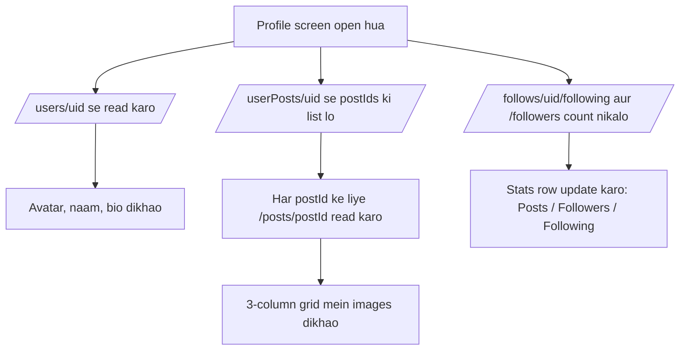
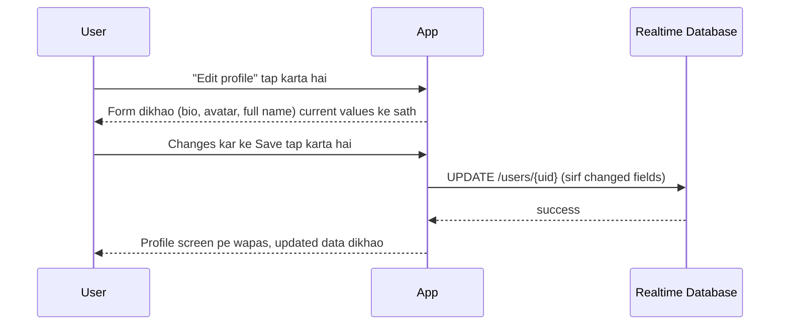
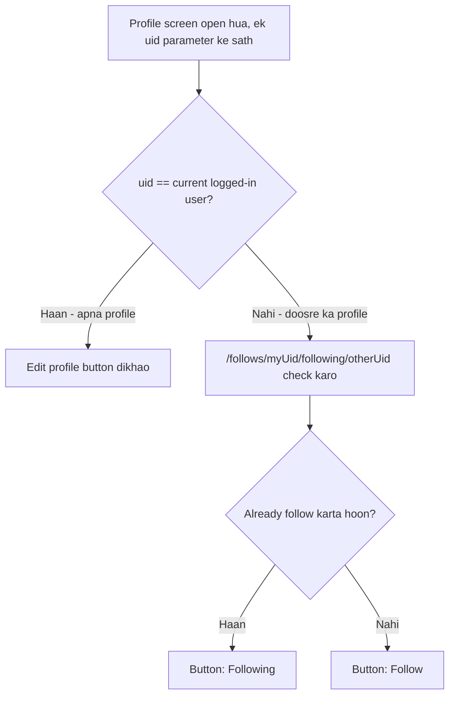

# Feature: Profile

User ka apna profile — avatar, bio, stats (posts/followers/following), aur uske posts ka grid.

## Screen
- **Profile** — avatar, username, full name, bio, stats row, "Edit profile" button, 3-column post grid, bottom nav

---

## Profile Load — Full Detail (Step by Step)

Jab user bottom nav se "**Profile**" tab tap karta hai:

1. App current logged-in user ka `uid` nikalta hai (`FirebaseAuth.getInstance().currentUser.uid`) — login mein already mil chuka hota hai
2. **Loading state** dikhao (skeleton/shimmer placeholders) jab tak data aa nahi jata
3. Ek saath (parallel) teen cheezein RTDB se mangwai jati hain:
   - `/users/{uid}` → username, full name, bio, avatarUrl
   - `/userPosts/{uid}` → is user ke sab post IDs ki list
   - `/follows/{uid}/following` aur `/follows/{uid}/followers` → count ke liye
4. `/users/{uid}` ka data aate hi **header section** render hota hai — avatar, naam, bio
5. `/follows` ka data aate hi **stats row** update hoti hai — `.getChildrenCount()` se follower/following ginti nikalti hai (RTDB mein pura data download kiye baghair bhi count mil sakta hai agar sirf count chahiye ho, lekin simple MVP mein pura node read kar ke `.size` nikal sakte ho)
6. `/userPosts/{uid}` se mile har `postId` ke liye, alag se `/posts/{postId}` read hota hai (image URL, caption) — yeh thoda "N+1 reads" wala pattern hai, MVP ke liye theek hai
7. Jaise jaise posts ka data aata hai, **3-column grid** mein thumbnails fill hoti jati hain
8. Agar user ke **koi posts nahi hain** (naya account) → grid ki jagah ek empty state dikhao: *"Abhi tak koi post nahi — pehli photo share karo"*

### Kab-kab yeh screen reload hoti hai?
- Jab tab pe wapas aao (bottom nav se)
- Jab Edit Profile se wapas aao (updated data dikhane ke liye)
- Jab khud ka naya post banaya ho (grid mein naya item add karne ke liye) — ya to manual refresh, ya real-time listener lagao `/userPosts/{uid}` pe

> MVP ke liye real-time listener zaroori nahi — screen har baar "open" hone par ek baar data fetch kar le, yeh kaafi hai. Follower count jaisi cheez har second change nahi hoti.

---

## Edit Profile — Full Detail (Step by Step)

1. User apne profile pe "**Edit profile**" button tap karta hai (yeh button sirf tab dikhta hai jab apna profile ho, kisi aur ka nahi)
2. Ek form screen/bottom-sheet khulta hai, **current values pehle se bhare hue** hote hain:
   - Avatar (tap kar ke badalne ka option)
   - Full name
   - Bio
3. User koi bhi field edit karta hai:
   - **Agar avatar badalta hai** → same flow jo [Create Post](03-create-post.md) mein hai: Android Photo Picker se image chuno → Cloudflare Worker se presigned URL mango → R2 pe upload karo → naya image URL milta hai
   - **Agar sirf bio/naam badalta hai** → koi upload nahi, seedha text hi hai
4. User "**Save**" tap karta hai
5. App client-side validate karta hai (e.g. bio ek max length se zyada to nahi — jaise Instagram ka 150 char limit)
6. App RTDB pe `UPDATE /users/{uid}` call karta hai — **sirf wahi fields jo change huye hain** (poora object overwrite nahi karna, warna `username` ya `createdAt` jaisi cheezein galti se delete/overwrite ho sakti hain)
7. **Success** → form band ho jata hai, Profile screen pe updated data turant dikhta hai (ya to RTDB se dobara read karo, ya jo values form mein the wahi local state mein use kar lo — "optimistic update")
8. **Fail** (e.g. internet nahi, ya upload beech mein fail) → error dikhao, form band mat karo, user ko dobara try karne do (unsaved changes form mein hi rahein)

### Edit Profile fail hone ke reasons

| Wajah | User ko kya dikhana hai |
|---|---|
| Internet nahi hai | "Internet connection check karo aur dobara try karo" |
| Naya avatar upload fail ho gaya | "Photo upload nahi ho saki — dobara try karo" (bio/naam ka save alag se ho sakta hai, avatar na bhi ho to) |
| Bio bohat lambi hai | "Bio 150 characters se zyada nahi ho sakti" (client-side hi rok do) |
| RTDB write fail | "Changes save nahi ho sake — dobara try karo" |

---

## Dusre Ka Profile Dekhna (Own vs. Others)

Yeh wahi **Profile screen** hai, bas ek farq ke sath — `uid` parameter doosre user ka hota hai:

1. User kisi post ke username pe tap karta hai (Feed mein), ya Search se kisi result pe tap karta hai
2. Profile screen khulta hai, lekin is baar `uid` = **doosre user ka uid** (apna nahi)
3. Data load same tarah hota hai (step-by-step upar wala process), bas `uid` alag hai
4. **Farq sirf UI mein hai:**
   - "Edit profile" button **gayab** ho jata hai
   - Uski jagah **"Follow" / "Following"** button dikhta hai (dekho [05-search.md](05-search.md) ke liye follow/unfollow ka data flow)
5. App pehle check karta hai: `/follows/{myUid}/following/{otherUid}` exist karta hai? Agar haan → button "Following" (outline) dikhao, warna "Follow" (filled) dikhao

---

## Flow Diagram — Profile Load

## Flow Diagram — Edit Profile

## Flow Diagram — Apna vs. Doosre Ka Profile

## RTDB Data Touched

| Path | Operation | Kab |
|---|---|---|
| `/users/{uid}` | read | Profile screen load (apna ya doosre ka) |
| `/userPosts/{uid}` | read | Post grid banane ke liye |
| `/posts/{postId}` | read (multiple) | Har grid item ki image/caption ke liye |
| `/follows/{uid}/following` | read (count) | Stats row |
| `/follows/{uid}/followers` | read (count) | Stats row |
| `/follows/{myUid}/following/{otherUid}` | read | Doosre ka profile — Follow button ka state pata karne ke liye |
| `/users/{uid}` | update | Edit profile save (sirf apna profile) |

## Design System Components
- `Avatar` (large size, profile header)
- `StatBlock` (number + label — Posts/Followers/Following)
- `PrimaryButton` / `SecondaryButton` ("Edit profile")
- `FollowButton` (doosre ka profile dekhte waqt)
- `PostGridItem` (square thumbnail)
- `BottomNavBar`

## Build Checklist
- [ ] Apna profile vs. kisi aur ka profile — same screen/composable, bas `uid` parameter aur ek `isOwnProfile: Boolean` flag se decide karo
- [ ] Post grid ke liye `LazyVerticalGrid` (Compose) use karo, 3 columns
- [ ] Avatar upload abhi ke liye simple rakho — same R2 + Worker pattern jo Create Post mein use hoga
- [ ] Stats count real-time nahi chahiye abhi — ek baar load karna kaafi hai (follower count har second change nahi hota)
- [ ] Edit Profile mein **partial update** use karo (`updateChildren` ya sirf changed fields ka map), poora object overwrite mat karo
- [ ] Loading state (skeleton) dikhao jab tak data aa nahi jata — khali safed screen mat dikhao

## Edge Cases
- Naya account jiske posts hi nahi hain → empty grid state dikhao ("No posts yet")
- Bio empty ho sakti hai — UI mein graceful handle karo
- Dusre ka profile dekh rahe ho to "Follow"/"Following" button dikhao, "Edit profile" nahi
- Edit Profile mein avatar change ho raha ho aur upload beech mein fail ho jaye → bio/naam ka save alag se chalne do, sirf avatar ka part fail mark karo
- Khud apna profile khud follow nahi kar sakta — "Follow" button khud ke profile pe kabhi nahi dikhna chahiye
