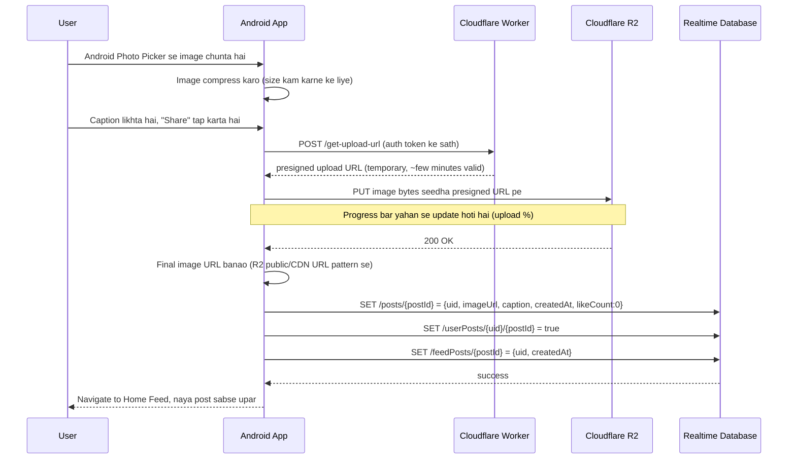

# Feature: Create Post

Sabse "heavy" feature — isme image upload + 2 alag storage systems (Cloudflare R2 for file, Firebase RTDB for data) connect hote hain.

## Screens
- **New post** — photo picker, caption input
- **New post (Uploading)** — selected image preview, progress bar

> MVP scope note: "Add location", "Tag people", aur "Advanced settings" Stitch design mein hain but v2 ke liye deferred hain (dekho [PROJECT_PLAN.md](../../PROJECT_PLAN.md) section 3).

## Flow Diagram — Full Upload Flow



## Flow Diagram — Error Handling

```mermaid
flowchart TD
    A[Upload shuru] --> B{Network available?}
    B -->|Nahi| C[Error: "No internet, try again" + Retry button]
    B -->|Haan| D{Worker se presigned URL mila?}
    D -->|Nahi| C
    D -->|Haan| E{R2 upload successful?}
    E -->|Nahi| C
    E -->|Haan| F{RTDB write successful?}
    F -->|Nahi| G["Image R2 pe hai but post record nahi bana — retry RTDB write only"]
    F -->|Haan| H[Success - Feed pe navigate karo]
```

## RTDB Data Touched

| Path | Operation | Kab |
|---|---|---|
| `/posts/{postId}` | write | Upload success ke baad |
| `/userPosts/{uid}/{postId}` | write | Upload success ke baad |
| `/feedPosts/{postId}` | write | Upload success ke baad |

## External Calls
| Call | Kya karta hai |
|---|---|
| Cloudflare Worker `POST /get-upload-url` | Presigned upload URL deta hai (R2 secret yahan hai, app mein nahi) |
| Cloudflare R2 `PUT <presigned-url>` | Actual image bytes upload karta hai |

## Design System Components
- `PrimaryButton` ("Share", disabled jab tak image na ho)
- `TextField` (caption, multi-line, char counter 0/2200)
- `ProgressBar` (upload %)
- `ImagePreview` (selected photo ka preview with "Change" option)

## Build Checklist
- [ ] Android Photo Picker integrate karo (`ActivityResultContracts.PickVisualMedia`)
- [ ] Image compress karo upload se pehle (e.g. max 1080px width, JPEG quality ~80%) — yeh data aur time dono bachata hai
- [ ] Cloudflare Worker banao jo ek authenticated request pe presigned URL return kare (Firebase Auth ka ID token verify karo Worker mein)
- [ ] Upload progress ke liye `OkHttp`/`Retrofit` ka progress-tracking request body use karo
- [ ] Teeno RTDB writes (`posts`, `userPosts`, `feedPosts`) ek sath, agar beech mein fail ho to retry logic socho

## Edge Cases
- Bohat badi image (phone camera se 10MB+ ho sakti hai) → compression zaroori hai
- App background mein chali jaye upload ke dauran → abhi MVP ke liye "upload cancel ho jaye" acceptable hai (background-safe upload WorkManager se v2 mein)
- Same image do baar accidentally share na ho (double-tap guard on Share button)

---

## Build Prompts (Claude ko dene ke liye)

Is feature mein do hisse hain: pehle Cloudflare Worker (backend), phir Android. Worker pehle banao, kyunke app usi par depend karti hai.

### Prompt 1 — Cloudflare Worker (presigned URL)
```
Cloudflare Worker (TypeScript, wrangler) likho jo POST /get-upload-url par Firebase ID token verify kare (Authorization: Bearer header), phir R2 bucket ke liye ek unique key (posts/{uid}/{timestamp}.jpg) ka presigned PUT URL aur final public imageUrl return kare. R2 keys sirf Worker secrets mein hon. Deploy ke steps aur ek curl test command bhi do. Har step samjhao.
```

### Prompt 2 — Photo Picker + preview
```
Create tab ki screen banao: Android Photo Picker (ActivityResultContracts.PickVisualMedia) se image select karo, ImagePreview component (Change option ke saath), caption TextField (multi-line, 0/2200 counter), PrimaryButton "Share" jo image ke baghair disabled ho. ViewModel mein state rakho.
```

### Prompt 3 — Image compress
```
Upload se pehle image ko max 1080px width par resize aur JPEG quality 80 par compress karne ka helper likho (background thread par). Before/after size log karo taake mujhe farq dikhe.
```

### Prompt 4 — Upload with progress
```
OkHttp se presigned URL par PUT upload karo, progress-tracking RequestBody ke saath, aur "Uploading" screen par ProgressBar (0-100%) dikhao. Worker se URL lene ke liye Firebase ID token bhejo. Share button ka double-tap guard lagao.
```

### Prompt 5 — RTDB writes + errors
```
Upload success ke baad /posts/{postId}, /userPosts/{uid}/{postId} aur /feedPosts/{postId} teeno ko ek hi multi-path updateChildren se atomically likho. Flow diagram ke error handling ke mutabiq: internet nahi / URL nahi mila / upload fail → Retry button; sirf RTDB write fail ho to upload dobara kiye baghair sirf RTDB write retry ho. Success par Home Feed par navigate karo.
```
