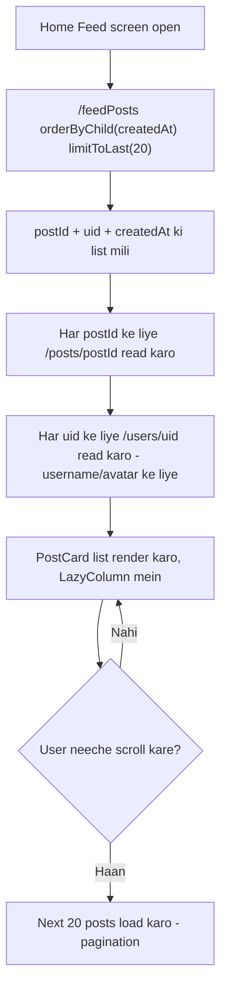
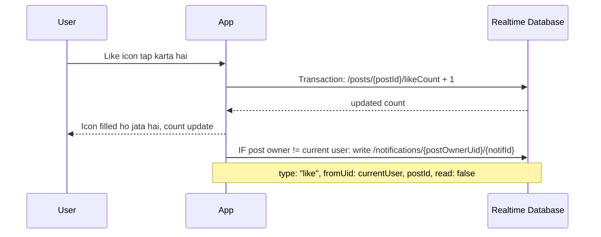

# Feature: Home Feed

App khulte hi sabse pehla screen — sab posts, newest sabse upar.

## Screen
- **Home Feed** — scrollable list of `PostCard` (image, username, like/comment icons, caption, "View all N comments")

## Flow Diagram — Feed Load

## Flow Diagram — Like a Post

## RTDB Data Touched

| Path | Operation | Kab |
|---|---|---|
| `/feedPosts` | read (ordered, limited) | Feed load + pagination |
| `/posts/{postId}` | read | Har post ki detail ke liye |
| `/users/{uid}` | read | Post ke author ka username/avatar |
| `/posts/{postId}/likeCount` | transaction (increment) | Like tap |
| `/notifications/{postOwnerUid}/{notifId}` | write | Like/comment hone par, post owner ko notify karne ke liye |

## Design System Components
- `PostCard` (image + header row + action icons + caption + comment-count link)
- `Avatar` (small, post header mein)
- `LikeButton` (filled/outline states)
- `BottomNavBar`

## Build Checklist
- [ ] `LazyColumn` + `ValueEventListener` ya `addChildEventListener` RTDB se — real-time updates ke liye
- [ ] Pagination: `limitToLast` + pehle wale se pehle item ka timestamp le kar agla batch fetch karo
- [ ] Like button ka state turant UI mein update karo (optimistic update), phir backend confirm hone do
- [ ] N+1 read problem se bacho — agar possible ho to ek hi listener se multiple posts batch mein read karo

## Edge Cases
- Koi post delete ho jaye lekin `/feedPosts` mein reference reh jaye → load karte waqt null-check karo
- Khud ke post ko like karne par notification khud ko mat bhejo
- Feed khali ho (naya account, koi follow nahi) → MVP mein "everyone's posts" hai is liye khali hona rare hai, lekin empty state zaroor handle karo
