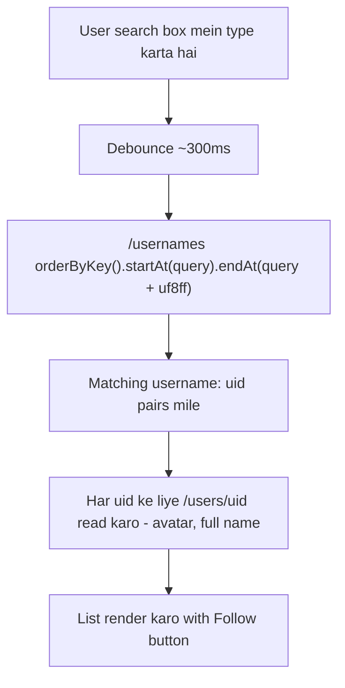
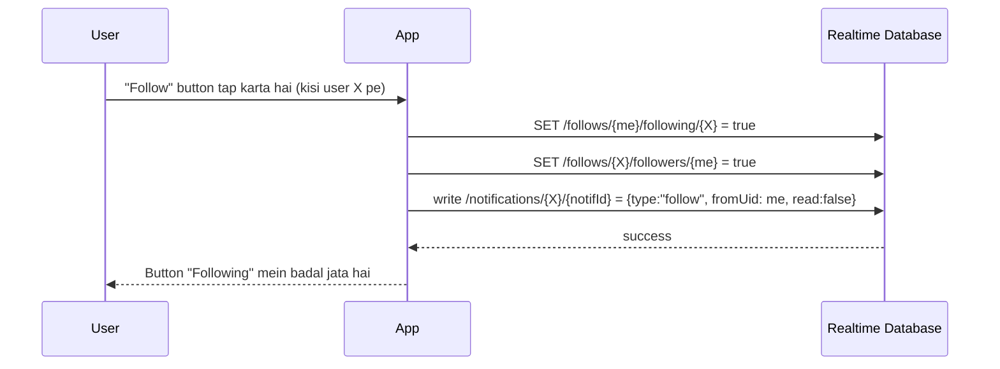

# Feature: Search

Username se doosre users dhoondna aur seedha wahin se follow karna.

## Screen
- **Search** — search bar, matching users ki list (avatar, username, full name, Follow button)

## Flow Diagram — Search

## Flow Diagram — Follow from Search

## RTDB Data Touched

| Path | Operation | Kab |
|---|---|---|
| `/usernames` | read (range query) | Har search keystroke (debounced) |
| `/users/{uid}` | read (multiple) | Search results ki details ke liye |
| `/follows/{me}/following/{X}` | write | Follow tap |
| `/follows/{X}/followers/{me}` | write | Follow tap (dono taraf se likhna padta hai) |
| `/notifications/{X}/{notifId}` | write | Follow hone par doosre ko batana |

## Design System Components
- `SearchBar`
- `ListRow` (avatar + username + full name + action button — Notifications screen se shared shape)
- `FollowButton` (filled "Follow" ↔ outline "Following")

## Build Checklist
- [ ] Search input pe debounce lagao (har keystroke pe query mat chalao, warna RTDB calls bohat zyada honge)
- [ ] Prefix search case-sensitive hota hai RTDB mein by default — username ko lowercase store karna consider karo taake search case-insensitive lage
- [ ] Follow button ka state turant toggle karo UI mein (optimistic), phir writes background mein confirm hon
- [ ] Khud ko search results mein mat dikhao

## Edge Cases
- Empty search box → koi results mat dikhao (ya recent/suggested users — v2 feature)
- Already-followed user dikhe to button "Following" se shuru ho, "Follow" se nahi
- Username mein special characters RTDB path mein allowed nahi hote (`.` `#` `$` `[` `]`) — signup ke waqt hi validate karna zaroori hai (dekho [01-users-auth.md](01-users-auth.md))
