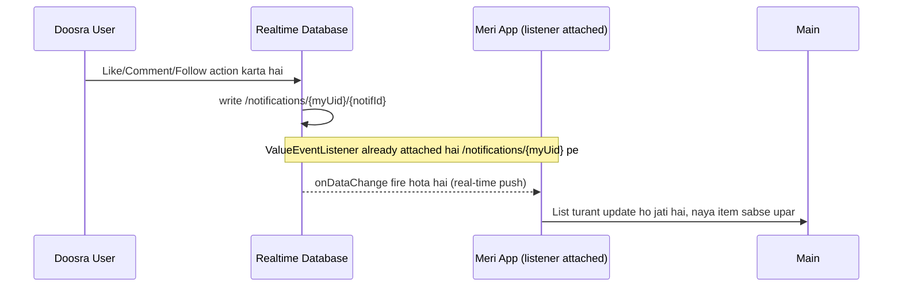
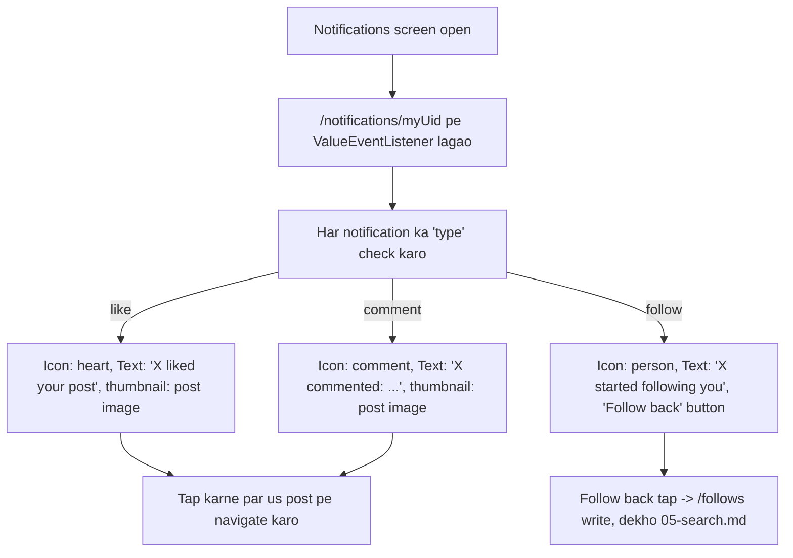

# Feature: Notifications

Real-time list — kisi ne like/comment/follow kiya to yahan dikhega. MVP mein **sirf in-app list**, push notification (FCM) nahi.

## Screen
- **Notifications** — list of events: "X liked your post", "X commented: ...", "X started following you" (with inline "Follow back")

## Flow Diagram — Receiving & Displaying Notifications



## Flow Diagram — Notification Screen Logic



## RTDB Data Touched

| Path | Operation | Kab |
|---|---|---|
| `/notifications/{myUid}` | real-time read (listener) | Screen open rehte waqt hamesha |
| `/notifications/{myUid}/{notifId}/read` | update | Notification tap karne par (read=true) |
| `/follows/...` | write | "Follow back" tap (dekho [05-search.md](05-search.md)) |

## Design System Components
- `ListRow` (Search se shared shape — avatar + text + action)
- `FollowButton` (outline "Follow back")
- `NotificationIcon` (type ke hisab se heart/comment/person icon)
- `BottomNavBar` (Activity tab active state)

## Build Checklist
- [ ] `ValueEventListener` ya Kotlin Flow wrapper (`callbackFlow`) se `/notifications/{uid}` real-time observe karo
- [ ] Listener ko screen leave karte waqt detach karna mat bhoolna (memory leak se bacho)
- [ ] Notification type ke hisab se alag UI render karo (sealed class `NotificationType` banana acha idea hai)
- [ ] Unread count badge bottom nav ke "Activity" icon pe (optional MVP+ polish)

## Edge Cases
- Post delete ho jaye lekin uski purani "liked your post" notification reh jaye → tap karne par graceful handle karo (post na mile to error state)
- Bohat zyada purani notifications → `limitToLast(50)` jaisi cap lagao, infinite list na ho
- Already followed user ko dobara "Follow back" dikhna nahi chahiye → state check karo

---

**Push Notifications (v2, abhi scope mein nahi):** Agar baad mein lock-screen push chahiye ho, to Firebase Cloud Messaging (FCM) + ek Cloud Function chahiye hoga jo `/notifications` mein naya write hote hi FCM message trigger kare. Yeh extra infrastructure hai, is liye MVP se bahar rakha gaya hai.

---

## Build Prompts (Claude ko dene ke liye)

Yeh feature Like (Feed) aur Follow (Search) ke baad banao, warna test karne ko notifications hi nahi hongi.

### Prompt 1 — Model + real-time stream
```
Notification ka sealed class model banao (Like, Comment, Follow) aur /notifications/{myUid} ko orderByChild("createdAt").limitToLast(50) ke saath callbackFlow se observe karne wala repository likho. awaitClose mein listener detach ho. Har notification ke fromUid ka /users aur (like/comment ke liye) post thumbnail bhi fetch karo.
```

### Prompt 2 — Notifications screen
```
Notifications (Activity tab) screen banao: LazyColumn mein ListRow, type ke hisab se NotificationIcon (heart/comment/person) aur text ("X liked your post", "X started following you"), newest upar. Follow type par outline FollowButton ("Follow back") — agar already follow karte ho to na dikhe. Empty state do.
```

### Prompt 3 — Read state + navigation
```
Notification tap par read = true update karo aur like/comment par us post par navigate karo (post delete ho chuki ho to graceful error state), follow par us user ke Profile par. Unread notifications ka halka highlight aur BottomNavBar ke Activity icon par unread count badge lagao.
```

### Prompt 4 — End-to-end test
```
Do accounts (ek phone, ek emulator) se test plan batao aur chalao: A ne B ki post like ki, A ne B ko follow kiya — B ki Notifications screen real-time update ho. Jo bug mile unhe list karo aur fix karo.
```
